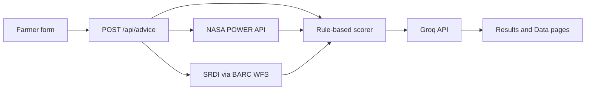

# How Field Shift works

Voice-over notes for the first NASA Space Apps video. Speak the API names. AppEEARS is not on the live request line: it is prefetched and read from cache.

NASA AppEEARS (SMAP soil moisture and MODIS greenness) is pulled ahead of time and cached. The farmer request does not call AppEEARS.

## APIs to name out loud

- **NASA POWER API** — `https://power.larc.nasa.gov/api/temporal/{climatology|monthly|daily}/point` — rain, maximum temperature, root-zone wetness. The Data page shows the 2001–2020 climatology normal.
- **NASA AppEEARS API** — `https://appeears.earthdatacloud.nasa.gov/api` — SMAP L4 (`SPL4SMGP.008`) soil moisture and MODIS NDVI (`MOD13Q1.061`). Prefetched, not called when the farmer submits.
- **BARC Crop Zoning WFS** — `https://map2.cropzoning.gov.bd/geoserver/wfs` — SRDI soil samples (pH, organic matter, texture). The app reads a local cache of this.
- **Groq Chat Completions API** — `https://api.groq.com/openai/v1` — model `openai/gpt-oss-120b`. Ranks and explains the top three. Numbers stay from the scorer.

Internal routes:

- `GET /api/unions` — fills the form dropdowns
- `POST /api/advice` — runs the whole pipeline
- `GET /api/climate` and `GET /api/soil` exist; the form does not use them

## Spoken script (~60–90 seconds)

**Hook.** In the Barind tract, a farmer needs a crop rotation that fits the rain they get, the soil they have, and the water they can actually pump.

**Input.** They pick their union, last season’s crops, budget, irrigation, and what they care about most: profit, soil, or water. The form loads unions from `GET /api/unions`, then sends that to `POST /api/advice`.

**Data.** Advice pulls NASA POWER climate normals for that point — twenty-year averages from 2001 to 2020. It reads cached NASA AppEEARS data for SMAP soil moisture and MODIS greenness. Local soil comes from SRDI, hosted on the BARC Crop Zoning WFS, already cached.

**Score, then explain.** Plain code scores the candidate rotations against rain, heat, soil, and the farmer’s priorities. Groq only ranks the top three and writes the explanation. It does not invent the numbers.

**If Groq is down.** The scorer ranking still shows. The app stays usable.

**Output.** The Results page shows the three rotations. The Data-behind-this page shows the POWER rain and temperature charts, the SRDI soil numbers, and the cached SMAP moisture.
