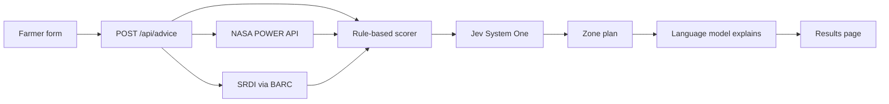

# How Orbit2Field decides

NASA AppEEARS (SMAP soil moisture and MODIS greenness) is pulled ahead of time and cached. The farmer request does not call AppEEARS.

Jev does not write text. It picks one rotation from the scorer's allowed list and answers a yes/no glut question for each rabi crop, using the English and Bangla headlines in `data/market/headlines.json`. Low confidence is flagged. The zone plan may move a farm off that pick so one upazila does not all plant the same crop, and Postgres remembers a farm that gave the top crop up.

The language model only explains the assignment that the server already made.
