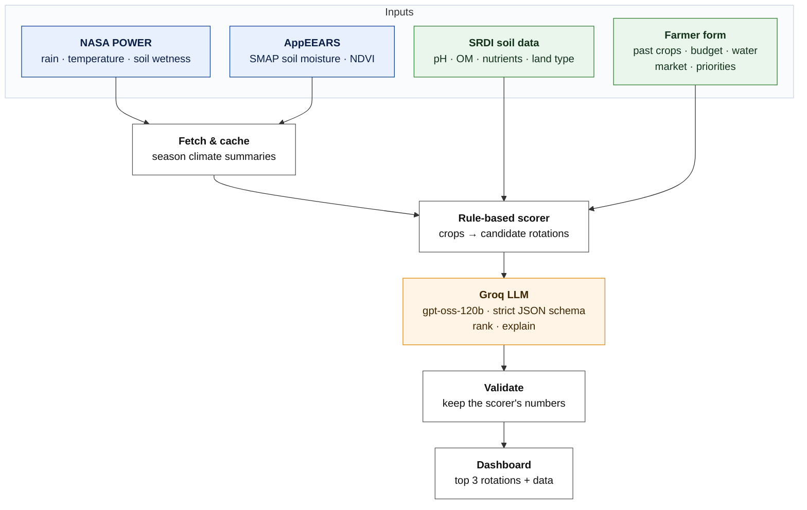

# Field Shift: Build Guide

**Prototype:** a crop-rotation advisor for the Barind tract, Bangladesh  
**Pilot area:** Godagari and Tanore upazilas, Rajshahi district  
**Team:** NASA Space Apps 2026, BRAC University  
**Guide written:** 1 Oct 2026 (Dhaka time)

This guide is for the coding agent that will build the web app. Read sections 1–3 to get the idea, then build from section 6, using sections 4–5 as reference.

---

## 1. Challenge

**Field Shift: Adapting Farms with NASA Data**

> "Farmers around the world navigate shifting temperatures, changing rainfall patterns, water shortages, extreme weather, and declining soil health. These pressures make it difficult to choose crop rotations that protect fields, conserve water, and support long-term resilience. Your challenge is to create a decision-support tool that uses NASA Earth observations along with local soil information, crop characteristics, and farmer priorities to help farmers explore rotation strategies that could strengthen soil health and adapt their farms to changing conditions."

**What we're building:** a farmer (or an extension officer helping one) picks their union and answers six short questions. The app combines NASA climate and soil-moisture data with SRDI soil data for that union. Plain code then scores the candidate crops and rotations. A Groq-hosted LLM (`openai/gpt-oss-120b`) ranks the top options, explains them, and returns JSON, and a dashboard shows the result. For example, the dashboard might compare *Boro–Fallow–T.Aman* (high water use) with *Mustard–Boro–T.Aman* or *Lentil–Fallow–T.Aman*.

---

## 2. Data sources

**MVP** means the prototype must use it. **Later** means it's planned but not needed for the demo.

| Source | What it gives | Access | Link | Stage |
|---|---|---|---|---|
| NASA POWER (AG community) | Daily/monthly/climatology rain, Tmax/Tmin, humidity, solar, root-zone soil wetness (`GWETROOT`) | REST, no login | [power.larc.nasa.gov/docs](https://power.larc.nasa.gov/docs/services/api/) | MVP |
| SMAP L4 `SPL4SMGP.008` via AppEEARS | Root-zone and surface soil moisture, 9 km, 3-hourly, 2015–now | AppEEARS API, Earthdata login | [AppEEARS API](https://appeears.earthdatacloud.nasa.gov/api/) | MVP |
| MODIS NDVI `MOD13Q1.061` via AppEEARS | 250 m, 16-day greenness, which shows the village-scale crop calendar | AppEEARS API, Earthdata login | [AppEEARS API](https://appeears.earthdatacloud.nasa.gov/api/) | MVP |
| HLS NDVI `HLSL30_VI.020` / `HLSS30_VI.020` | 30 m NDVI for per-field crop history (Boro vs fallow) | AppEEARS API, Earthdata login | [AppEEARS API](https://appeears.earthdatacloud.nasa.gov/api/) | Later |
| GPM IMERG `GPM_3IMERGDL.07` (Late) / Final | 0.1° daily rain, better than POWER for the monsoon | GES DISC download/OPeNDAP, Earthdata login | [CMR collection](https://cmr.earthdata.nasa.gov/search/concepts/C2723754859-GES_DISC.html) | Later |
| VIIRS NDVI `VNP13A1.002`, MODIS ET `MOD16A2GF.061` | MODIS successor NDVI; actual evapotranspiration (crop water use) | AppEEARS API, Earthdata login | [AppEEARS API](https://appeears.earthdatacloud.nasa.gov/api/) | Later |
| **SRDI soil samples** (upazila survey) | Per-sample pH, OM, N, P, K, S, Zn, B, Ca, Mg, Cu, Fe, Mn, texture, land type, soil series, with coordinates | Public WFS on BARC Crop Zoning GeoServer (SRDI data) | [map2.cropzoning.gov.bd](https://map2.cropzoning.gov.bd/geoserver/wfs?service=WFS&version=2.0.0&request=GetCapabilities) | MVP |
| **SRDI land & soil units** (1:50,000) | Land type, drainage, texture, pH class, moisture, water recession, AEZ per map unit | Same WFS | as above | MVP |
| **SRDI fertilizer recommendations** | Union-level fertilizer doses per crop, derived from SRDI soil tests | Public lookup form (cached offline) | [frs-bd.com](http://frs-bd.com/) | MVP (cached) |
| BARC crop suitability (from SRDI data) | Upazila area that is very suitable → not suitable, per crop | XLS download | [BARC Crop Zoning downloads](https://apps.barc.gov.bd/cropzoning/homes/downloads/1) | MVP (prior) |
| Groq API (free plan) | Ranks the candidates, explains them, returns JSON that matches our schema | REST (OpenAI-compatible), bearer key | [console.groq.com/docs](https://console.groq.com/docs/structured-outputs) | MVP |

**Soil data rule:** MD decided that local soil data comes only from SRDI. Every soil table above is SRDI data. BARC hosts two of them, and the BARC suitability table is derived from SRDI surveys. There's no SoilGrids.

---

## 3. Pipeline



The numbers come from code. The LLM decides the order of the top three (within limits) and writes the explanation. If Groq fails (or we hit the free-tier limit on both models), the app still shows the scorer's ranking. This keeps the output repeatable and easy to defend in front of judges.

---

## 4. API details

All secrets come from environment variables (see `.env.example`). The real values live in `secrets/earthdata.env` and `secrets/groq.env`. **Never** copy them into code, logs or this guide.

### 4.1 NASA POWER: tested live ✅

| | |
|---|---|
| Base URL | `https://power.larc.nasa.gov/api/temporal/{daily\|monthly\|climatology}/point` |
| Auth | None |
| Key params | `parameters` (comma list, max 20 per point request), `community=AG`, `latitude`, `longitude`, `start`/`end` (`YYYYMMDD` for daily, `YYYY` for monthly), `format=JSON` |
| Parameters we use | `T2M`, `T2M_MAX`, `T2M_MIN`, `PRECTOTCORR` (mm/day), `RH2M`, `ALLSKY_SFC_SW_DWN`, `GWETROOT`, `GWETTOP` (0–1 wetness) |
| Barind points | Godagari 24.47 N, 88.33 E (pilot default). Tanore 24.60 N, 88.50 E. Every union's point is in `pilot_unions.json`. |
| Resolution | Meteorology 0.5° × 0.625°. The whole pilot area falls in one or two cells, so request **once per grid cell**, not once per union. |
| Rate limits | No published quota. POWER returns `429` when throttled, and the team has said it blocks clients that keep requesting the same location ([forum](https://forum.earthdata.nasa.gov/viewtopic.php?t=4273), [daily API docs](https://power.larc.nasa.gov/docs/services/api/temporal/daily/)). A 30 requests/min cap on climatology was reported in [nasapower #57](https://github.com/ropensci/nasapower/issues/57). Cache everything. |

**Sample request** (run 1 Oct 2026, HTTP 200, about 1 s):

```bash
curl "https://power.larc.nasa.gov/api/temporal/monthly/point?parameters=T2M,T2M_MAX,T2M_MIN,PRECTOTCORR,RH2M,ALLSKY_SFC_SW_DWN,GWETROOT,GWETTOP&community=AG&longitude=88.33&latitude=24.47&start=2023&end=2024&format=JSON"
```

**Real response, trimmed** (the full files are in `samples/power_*.json`):

```json
{
  "type": "Feature",
  "geometry": { "type": "Point", "coordinates": [88.33, 24.47, 27.43] },
  "properties": { "parameter": {
    "PRECTOTCORR": { "202401": 1.45, "202404": 0.04, "202407": 9.57, "202409": 11.49, "202413": 3.86 },
    "T2M_MAX":     { "202401": 25.02, "202404": 46.27, "202405": 44.45, "202413": 46.27 },
    "GWETROOT":    { "202401": 0.56, "202404": 0.38, "202410": 0.85, "202413": 0.59 }
  }},
  "header": { "api": { "version": "v2.10.0" }, "sources": ["SYN1DEG", "MERRA2", "POWER"],
              "fill_value": -999.0, "time_standard": "LST", "start": "20230101", "end": "20241231" },
  "parameters": { "PRECTOTCORR": { "units": "mm/day", "longname": "Precipitation Corrected" },
                  "GWETROOT": { "units": "1", "longname": "Root Zone Soil Wetness" } }
}
```

Things to know when parsing:

- Monthly keys are `YYYYMM`. Key `YYYY13` is the annual value.
- Monthly `PRECTOTCORR` is a **mean daily rate**, so multiply it by the days in the month.
- `-999` means missing.

The climatology endpoint (2001–2020 normals) gives, for Godagari:

| | Rabi (Nov–Feb) | Kharif-1 (Mar–Jun) | Kharif-2 (Jul–Oct) | Year |
|---|--:|--:|--:|--:|
| Normal rain (mm) | 31 | 419 | 820 | ≈1,270 |

April's mean daily Tmax peaked at **46.3 °C** in 2024. These are the two numbers that make the case for low-water, heat-escaping Rabi crops.

### 4.2 AppEEARS (SMAP, MODIS, HLS, VIIRS): tested live ✅

| | |
|---|---|
| Base URL | `https://appeears.earthdatacloud.nasa.gov/api` |
| Auth | `POST /login` with **HTTP basic auth** (`EARTHDATA_USERNAME` / `EARTHDATA_PASSWORD`) returns `{"token_type":"Bearer","token":"…","expiration":"…"}`. Send `Authorization: Bearer <token>` on every task, status and bundle call. The docs say the token lasts about 48 h. The token we got today expired in about 24 h, so re-login whenever you get a `403`. |
| Public (no auth) | `GET /product`, `GET /product/{product_id}` (layer names), `GET /spatial/proj`, `GET /quality/...` |
| Flow | `POST /login` → `POST /task` (returns `202` + `task_id`) → poll `GET /status/{task_id}` → `GET /bundle/{task_id}` (file list) → `GET /bundle/{task_id}/{file_id}` (302 to S3, follow redirects) |
| Rate limits | No numbers published. The API returns `429` if you go too fast. Tasks are queued: our 4-layer point task took **{{APPEEARS_MINUTES}}**. Never call AppEEARS during a user request. Pull data with a script and cache it. |

Product and layer names (checked live against `/product/{id}` on 1 Oct 2026):

| Product | Layer(s) to request | Notes |
|---|---|---|
| `SPL4SMGP.008` | `Geophysical_Data_sm_rootzone` (m³/m³, 0–100 cm), `Geophysical_Data_sm_surface`, `Geophysical_Data_sm_rootzone_pctl` (percentile) | 9 km, 3-hourly. Average to daily. |
| `SPL3SMP_E.006` | `Soil_Moisture_Retrieval_Data_AM_soil_moisture` | 9 km daily, surface only. Optional cross-check. |
| `MOD13Q1.061` | `_250m_16_days_NDVI` (QA: `_250m_16_days_VI_Quality`) | 250 m, 16-day |
| `VNP13A1.002` | `500_m_16_days_NDVI` | 500 m, the MODIS successor (Terra MODIS winds down in 2027) |
| `HLSL30_VI.020`, `HLSS30_VI.020` | `NDVI` (also EVI, NDMI, SAVI…) | 30 m. Clouds leave gaps in the monsoon. |
| `MOD16A2GF.061` | `ET_500m` | 8-day actual ET |

**Login** (prints only the expiry, never the token):

```bash
curl -s -X POST -u "$EARTHDATA_USERNAME:$EARTHDATA_PASSWORD" -H "Content-Length: 0" \
  https://appeears.earthdatacloud.nasa.gov/api/login | jq '{token_type, expiration}'
```

**Submit a point task.** This is the exact request we ran (`samples/appeears_task_request.json`):

```json
{
  "task_type": "point",
  "task_name": "fieldshift-godagari-test",
  "params": {
    "dates": [{ "startDate": "01-01-2024", "endDate": "04-30-2024" }],
    "layers": [
      { "product": "SPL4SMGP.008",  "layer": "Geophysical_Data_sm_rootzone" },
      { "product": "SPL4SMGP.008",  "layer": "Geophysical_Data_sm_surface" },
      { "product": "MOD13Q1.061",   "layer": "_250m_16_days_NDVI" },
      { "product": "HLSL30_VI.020", "layer": "NDVI" }
    ],
    "coordinates": [{ "id": "godagari", "category": "pilot", "latitude": 24.47, "longitude": 88.33 }]
  }
}
```

```bash
curl -X POST -H "Authorization: Bearer $APPEEARS_TOKEN" -H "Content-Type: application/json" \
  --data @samples/appeears_task_request.json https://appeears.earthdatacloud.nasa.gov/api/task
# → 202 {"task_id": "badb84d5-84b9-410c-bd13-e9b119b5faf5", "status": "pending"}
```

Dates are `MM-DD-YYYY`. For per-field (HLS) work, send `task_type: "area"` with a GeoJSON polygon in `params.geo` and `output: {format: {type: "geotiff"}, projection: "geographic"}`.

**Response shape.** A finished point task gives one CSV per product, plus a request JSON, a granule list and a README. Each CSV row is one date at one point: `ID, Latitude, Longitude, Date, MODIS_Tile, <PRODUCT>_<LAYER>, …QA columns`.

{{APPEEARS_SAMPLE}}

### 4.3 Earthdata direct: CMR and GES DISC (for IMERG, later)

| | |
|---|---|
| CMR search | `https://cmr.earthdata.nasa.gov/search/{collections\|granules}.json`. Public; send `Authorization: Bearer $EARTHDATA_TOKEN` to include restricted items. **Tested: 200.** |
| Downloads | `https://data.gesdisc.earthdata.nasa.gov/data/...`, using bearer `EARTHDATA_TOKEN` or `~/.netrc` for `urs.earthdata.nasa.gov` (`curl -n -L -c cookies -b cookies`) |
| Subsetting | OPeNDAP: `https://opendap.earthdata.nasa.gov/collections/C2723754859-GES_DISC/granules/<granule>.dap.csv?dap4.ce=/precipitation[0][<lon_i>][<lat_i>]`. For IMERG V07 (0.1°, dims time·lon·lat), Godagari is `lon_i = 2683`, `lat_i = 1144`. |
| Token | `EARTHDATA_TOKEN` is an EDL user token. The current one **expires 30 Nov 2026**. Make a new one with `curl -X POST -u "$EARTHDATA_USERNAME:$EARTHDATA_PASSWORD" https://urs.earthdata.nasa.gov/api/users/token` and update `secrets/earthdata.env`. |

```bash
curl -H "Authorization: Bearer $EARTHDATA_TOKEN" \
 "https://cmr.earthdata.nasa.gov/search/granules.json?short_name=GPM_3IMERGDL&version=07&temporal=2024-07-01T00:00:00Z,2024-07-01T23:59:59Z"
# → feed.entry[0].title = "GPM_3IMERGDL.07:3B-DAY-L.MS.MRG.3IMERG.20240701-S000000-E235959.V07B.nc4"
```

⚠️ **Blocked until MD clicks one button.** The GES DISC download returned `401 "Pre authorization required for this application"`, and OPeNDAP returned 403. MD needs to log in to Earthdata once and approve **NASA GESDISC DATA ARCHIVE** at <https://urs.earthdata.nasa.gov/approve_app?client_id=e2WVk8Pw6weeLUKZYOxvTQ>. Until then, IMERG stays "Later". POWER covers rainfall for the MVP.

### 4.4 Groq LLM: tested live ✅

We use **[Groq](https://groq.com)**, the fast LLM inference service, on its free plan. This is not xAI's Grok. Every fact below comes from Groq's official docs as of 1 Oct 2026: [API reference](https://console.groq.com/docs/api-reference), [structured outputs](https://console.groq.com/docs/structured-outputs), [rate limits](https://console.groq.com/docs/rate-limits), [models](https://console.groq.com/docs/models) and [reasoning](https://console.groq.com/docs/reasoning).

| | |
|---|---|
| Base URL | `https://api.groq.com/openai/v1`. It's OpenAI-compatible, so the `openai` npm/pip SDK works once you set `baseURL`. `groq-sdk` also works. |
| Endpoint | `POST /chat/completions`. `GET /models` lists the models your key can use. |
| Auth | `Authorization: Bearer $GROQ_API_KEY` (from `secrets/groq.env`) |
| **Recommended model** | **`openai/gpt-oss-120b`**. A production model with **strict** structured outputs, a 131k context, about 500 tok/s and up to 65,536 completion tokens. It's the strongest model that guarantees our schema. |
| **Fallback model** | **`openai/gpt-oss-20b`**. Also production with strict outputs, and about twice as fast (about 1000 tok/s). It has its **own per-model quota**, so it still works when the 120b limit is used up. |
| Strict JSON schema (`strict: true`) | Supported by `openai/gpt-oss-20b`, `openai/gpt-oss-120b` and `qwen/qwen3.8-27b` (preview). Uses constrained decoding: "guaranteed to match your schema". |
| Best-effort JSON schema (`strict: false`) | The three above plus `openai/gpt-oss-safeguard-20b`. If the output doesn't match, the API returns `400` "Generated JSON does not match the expected schema". |
| JSON mode only | Every other chat model, e.g. `llama-3.3-70b-versatile` and `llama-3.1-8b-instant`. These only take `response_format: {type: "json_object"}`, which gives valid JSON but no schema guarantee. We don't use them. |
| Strict-mode rules | Every property must be in `required`, and every object needs `additionalProperties: false`. Optional fields use a `["type","null"]` union. The documented keywords are `string, number, boolean, integer, object, array, enum, anyOf, $defs/$ref` (recursion allowed). Streaming and tool use can't be combined with structured outputs. |
| Reasoning | The gpt-oss models are reasoning models. Send `reasoning_effort: "low"` (low, medium or high) and `include_reasoning: false`. Reasoning tokens count toward your token limits, and the default `max_completion_tokens` of 1024 is too small for our output, so set about **3000**. |
| **Free-tier limits** (per organisation, per model) | `openai/gpt-oss-120b`: **30 RPM · 1,000 RPD · 8,000 TPM · 200,000 TPD**. `openai/gpt-oss-20b`: **30 RPM · 1,000 RPD · 8,000 TPM · 200,000 TPD**. These are the [rate-limits page](https://console.groq.com/docs/rate-limits) figures. The models page lists the paid Developer plan at 250K TPM / 1K RPM. Your org's actual limits are on [console.groq.com/settings/limits](https://console.groq.com/settings/limits). |
| What 8K TPM means | One advice call uses about 2.5k prompt tokens plus 1.5–3k output and reasoning tokens. That allows **about 2 calls per minute per model**, so cache responses by payload hash (§6.3) and fall back to the 20b model on `429`. |
| Errors and headers | Over the limit you get `429` with a `retry-after` header. `x-ratelimit-remaining-requests` counts against RPD, and `x-ratelimit-remaining-tokens` counts against TPM. |
| Status | ✅ **Tested live on 1 Oct 2026, 13:35 BDT, with `openai/gpt-oss-120b`** in strict mode with our schema (`tools/groq_live_test.py`). HTTP 200 in 3.76 s round-trip. Usage: 1,595 prompt + 1,582 completion = **3,177 tokens**, of which 101 were reasoning. The output validated against the schema. For offline work and demos, keep the mock (`data/mock/llm_response.json`). A starter copy is in `samples/llm_response.mock.json` and validates against the schema. To run the one-call smoke test, use `tools/groq_live_test.py`. |

**Sample request (curl):**

```bash
set -a; . secrets/groq.env; set +a          # loads GROQ_API_KEY; never echo it
curl -s https://api.groq.com/openai/v1/chat/completions \
  -H "Authorization: Bearer $GROQ_API_KEY" -H "Content-Type: application/json" \
  -d @- <<JSON
{
  "model": "openai/gpt-oss-120b",
  "reasoning_effort": "low", "include_reasoning": false, "max_completion_tokens": 3000,
  "messages": [
    {"role": "system", "content": "…SYSTEM_PROMPT from §6.5…"},
    {"role": "user",   "content": "{\"location\":{\"upazila\":\"Tanore\",\"union\":\"Kalma\"}, …}"}
  ],
  "response_format": {"type": "json_schema",
    "json_schema": {"name": "rotation_advice", "strict": true,
                    "schema": $(cat schemas/rotation_advice.schema.json)}}
}
JSON
```

**Sample request (TypeScript, `openai` SDK pointed at Groq):** this goes in `lib/llm.ts`.

```ts
import OpenAI from "openai";
import schema from "@/schemas/rotation_advice.schema.json";

const groq = new OpenAI({
  apiKey: process.env.GROQ_API_KEY,
  baseURL: process.env.GROQ_BASE_URL ?? "https://api.groq.com/openai/v1",
});

export async function getAdvice(payload: object, model = process.env.GROQ_MODEL ?? "openai/gpt-oss-120b") {
  const completion = await groq.chat.completions.create({
    model,
    messages: [
      { role: "system", content: SYSTEM_PROMPT },          // section 6.5
      { role: "user", content: JSON.stringify(payload) },  // scorer output + context
    ],
    response_format: {
      type: "json_schema",
      json_schema: { name: "rotation_advice", schema, strict: true },
    },
    max_completion_tokens: 3000,
    // Groq-specific fields; the openai SDK passes them through unchanged
    reasoning_effort: "low",
    // @ts-expect-error not in the OpenAI types
    include_reasoning: false,
  });
  return JSON.parse(completion.choices[0].message.content!);
}
// On 429/5xx: retry once with process.env.GROQ_FALLBACK_MODEL ("openai/gpt-oss-20b"),
// then fall back to the scorer-only result (section 6.5).
```

With `groq-sdk`, the call is the same: `new Groq({ apiKey })` followed by `groq.chat.completions.create({...})`, with no `baseURL`.

**Response shape:** the usual chat-completions object. `choices[0].message.content` is a JSON string that matches the schema. `usage` has `prompt_tokens`, `completion_tokens` and `total_tokens`, and Groq adds timing fields such as `queue_time` and `total_time`.

**Live test result** (1 Oct 2026, 13:35 BDT). The full output is in `samples/groq_live_response.json`. This was a real call with the Kalma (Tanore) payload: soil pH 6.2, OM 1.70%, 31 mm normal Rabi rain, FRS lentil doses, and candidates R1, R3 and R5.

| | |
|---|---|
| Model | `openai/gpt-oss-120b`, `reasoning_effort: "low"`, `strict: true` |
| HTTP / latency | `200`, 3.76 s round-trip. Groq reported `total_time` 3.43 s and `queue_time` 0.25 s. |
| Tokens | prompt 1,595 · completion 1,582 (reasoning 101) · **total 3,177** |
| Rate-limit headers | `x-ratelimit-limit-requests: 1000` (per day), `x-ratelimit-limit-tokens: 8000` (per minute), and 6135 tokens remaining after the call. These match the free-tier table. |
| Result | Schema-valid. Ranked R3 > R5 > R1, so lentil came first, which fits the "water 5 / soil 4" priorities. Every number was copied from the scorer input. |

```json
{
  "model": "openai/gpt-oss-120b",
  "finish_reason": "stop",
  "usage": {
    "prompt_tokens": 1595,
    "completion_tokens": 1582,
    "total_tokens": 3177,
    "reasoning_tokens": 101,
    "total_time_s": 3.43,
    "queue_time_s": 0.25
  },
  "content": {
    "location": {
      "upazila": "Tanore",
      "union": "Kalma"
    },
    "summary": "Start with a lentil crop, then let the field lie fallow before planting T. Aman. If you prefer a less profitable but very water‑saving option, grow mustard after fallow and finish with T. Aman. Keep the current Boro–Fallow–T.Aman pattern only as a fallback.",
    "rotations": [
      {
        "rank": 1,
        "rotation_id": "R3",
        "name": "Lentil – Fallow – T.Aman",
        "seasons": {
          "kharif1": {
            "crop": "lentil",
            "months": "Nov–Feb"
          },
          "kharif2": {
            "crop": "fallow",
            "months": "Mar–Jun"
          },
          "rabi": {
            "crop": "t_aman",
            "months": "Jul–Oct"
          }
        },
        "scores": {
          "overall": 78,
          "water": 90,
          "soil_health": 82,
          "profit": 61,
          "climate_risk": 74
        },
        "water_use": {
          "irrigation_mm": 105,
          "change_vs_current_pct": -89,
          "note": "Uses 89% less irrigation than the current Boro system."
        },
        "soil_health_effect": {
          "direction": "improves",
          "explanation": "Lentil adds nitrogen and breaks disease cycles, boosting soil health."
        },
        "reasons": [
          "Overall score 78 is highest among candidates.",
          "Water score 90 and irrigation drop of 89% match the farmer's limited water priority.",
          "…"
        ],
        "risks": [
          {
            "risk": "Lentil may need timely rain during the early growth stage.",
            "mitigation": "Use the limited irrigation budget to apply a small pulse at sowing."
          }
        ],
        "confidence": {
          "level": "high",
          "uncertainty_note": "Scores are based on region‑wide data and match the farmer's water constraint."
        }
      },
      "… rank 2 = R5, rank 3 = R1 (trimmed)"
    ],
    "not_recommended": [],
    "data_caveats": [
      "Rainfall data are long‑term normals and may vary year to year.",
      "…"
    ]
  }
}
```

⚠️ **Lesson from the live call: the schema can be valid while the content is wrong.** The model put lentil under `kharif1` and T.Aman under `rabi`, so the season keys were shuffled even though the crop order was right. Strict mode guarantees the *shape*, not agronomic sense. The fix is in `lib/llm.ts`: **overwrite `seasons` from the candidate definition**, the same way we overwrite `scores`, and let the LLM write only the text fields. Add a zod refinement as well: each season's crop must equal the candidate's crop for that season.

**Output schema** (`schemas/rotation_advice.schema.json`), **adjusted for Groq strict mode**:

```text
RotationAdvice
├─ location            { upazila, union }
├─ summary             2–3 plain sentences
├─ rotations[]         exactly 3, checked in code
│   ├─ rank, rotation_id (must be a candidate id), name
│   ├─ seasons         { rabi:{crop,months}, kharif1:{crop,months}, kharif2:{crop,months} }
│   ├─ scores          { overall, water, soil_health, profit, climate_risk }  0–100, overwritten by scorer
│   ├─ water_use       { irrigation_mm, change_vs_current_pct, note }
│   ├─ soil_health_effect { direction: improves|neutral|degrades, explanation }
│   ├─ reasons[]       2–4, checked in code
│   ├─ risks[]         0–3 { risk, mitigation }
│   └─ confidence      { level: low|medium|high, uncertainty_note }
├─ not_recommended[]   { rotation_id, why }
└─ data_caveats[]      ≤ 4
```

**Changes made for Groq strict mode** (compared with the earlier xAI version):

1. Removed `$schema` and `title`. Groq's docs don't list them as supported.
2. Removed `minItems`, `maxItems`, `maxLength`, `minimum` and `maximum`. Groq's strict-mode docs don't list them, so they may be rejected or ignored. The limits now live in each field's `description` (the model reads them) and are **enforced in zod** after parsing.
3. Changed `seasons` from an array of three `{season, crop, months}` items to a fixed object `{rabi, kharif1, kharif2}`. Without `minItems`/`maxItems`, an object is the only way to guarantee exactly one entry per season.
4. Kept everything else the same. Every object still has all its properties in `required` and `additionalProperties: false` (checked by script), and the enums are unchanged.

**zod checks** (`lib/advice.ts`):
- `rotations.length === 3`, with ranks 1, 2, 3
- reasons 2–4, risks ≤ 3, caveats ≤ 4
- scores 0–100
- `rotation_id` must be in the candidates
- strings ≤ 300 characters

Example of one ranked item, showing the shape only. The values are illustrative, not real model output:

```json
{
  "rank": 1, "rotation_id": "R3", "name": "Lentil – Fallow – T.Aman",
  "seasons": {
    "rabi":    { "crop": "lentil", "months": "Nov–Feb" },
    "kharif1": { "crop": "fallow", "months": "Mar–Jun" },
    "kharif2": { "crop": "t_aman", "months": "Jul–Nov" }
  },
  "scores": { "overall": 78, "water": 90, "soil_health": 82, "profit": 61, "climate_risk": 74 },
  "water_use": { "irrigation_mm": 105, "change_vs_current_pct": -89, "note": "Replaces Boro, the largest dry-season water user." },
  "soil_health_effect": { "direction": "improves", "explanation": "Lentil fixes nitrogen; soil OM here is about 1.7%, which is low." },
  "reasons": ["Lentil is suitable on most of Tanore's land in the BARC/SRDI zoning."],
  "risks": [{ "risk": "Late sowing pushes flowering into February heat.", "mitigation": "Sow by mid-November." }],
  "confidence": { "level": "medium", "uncertainty_note": "Climate is from a ~50 km grid; soil survey date unknown." }
}
```

### 4.5 SRDI data endpoints

| | |
|---|---|
| WFS base | `https://map2.cropzoning.gov.bd/geoserver/wfs`. A public OGC service; no auth seen. |
| Layers (per upazila, by BBS geocode) | `wsBARC:upazila_sol_<geo>` (soil samples), `wsBARC:edaphic_data_<geo>` (land/soil units), `wsBARC:union_boundary_en_<geo>`. Godagari = `508134`, Tanore = `508194`. |
| Sample request | `?service=WFS&version=1.1.0&request=GetFeature&typeName=wsBARC:upazila_sol_508134&outputFormat=application/json&srsName=EPSG:4326` |
| Response | GeoJSON FeatureCollection. The `upazila_sol` properties are `smpl_no, mu, land_type, sg_name, texture, ph, ec, om, n, po, k, s, zn, b, ca, mg, cu, fe, mn`. |
| Rate limits | None published. It's a government server, so pull once with `scripts/srdi_refresh.py` and ship the CSVs. |
| FRS fertilizer | `http://frs-bd.com/` is an ASP.NET form with no API. We walked the public dropdowns with a script (`srdi_raw/frs_scrape.py`) without logging in or saving anything. **Do not call it from the app**; use `srdi_frs_fertilizer.csv`. |

---

## 5. SRDI data

### What we fetched

All files are in `/workspace/space-apps-prototype/`. Every row has a `source_url`.

| File | Rows | What it is |
|---|--:|---|
| `srdi_sample.csv` | 476 | **SRDI soil-test samples**: 260 in Godagari and 216 in Tanore. Each has coordinates, union, land type, soil series, texture, pH, OM, N, P, K, S, Zn, B, Ca, Mg, Cu, Fe, Mn. |
| `srdi_land_units.csv` | 86 | SRDI 1:50,000 land/soil units: area (ha), AEZ, land type, soil series, landform, texture, consistency, drainage, pH class, moisture, slope, salinity, water recession |
| `srdi_frs_fertilizer.csv` | {{FRS_ROWS}} | SRDI FRS fertilizer doses (g per decimal and kg/ha) for {{FRS_COVERAGE}} |
| `barc_suitability_pilot.csv` | 28 | BARC suitability areas (ha) for 14 crops in both upazilas, derived from SRDI land/soil data |
| `pilot_unions.json` | 52 | Union and paurashava-ward names (EN/BN), geocodes, a lat/lon point and the FRS union code |

The samples were assigned to unions by point-in-polygon against the BARC union boundaries, and all 476 fell inside a polygon.

### Preview: median soil values by union

Paurashava wards are left out here but kept in the CSV.

{{UNION_TABLE}}

Units follow the usual SRDI convention: OM and N in %; K, Ca and Mg in meq/100 g; P, S, Zn, B, Cu, Fe and Mn in µg/g (ppm). The layer itself doesn't state units, so **confirm them with SRDI**.

### What the data says

- **Tanore is acidic and Godagari is mostly neutral.** By soil-unit area, 87% of Tanore is "moderately acidic" and 80% of Godagari is "neutral".
- **Both upazilas are high, dry land.** High land covers 73% of Godagari and 87% of Tanore. Soil moisture is "Low" in 66 of the 86 units, and water recedes "Very early" or "Early" in 65.
- **Organic matter is low:** the median is 1.68% across all samples.
- **The FRS doses agree with the lab data.** Kalma (Tanore, median pH 6.2) is told to add 100 kg/ha of lime and, for Boro, about 7× more TSP (143 vs 20 kg/ha) than Char Ashariadaha (Godagari, pH 7.9).
- Char Ashariadaha, on the Padma floodplain, is the exception. It is alluvial ("poli") soil, not Barind "khiyar" soil, with pH around 7.9.

### BARC suitability for the pilot (share of upazila area)

{{BARC_TABLE}}

Boro rice is marginal on most of the pilot land, while lentil, mustard and maize are suitable on 85–93% of it. That is the core story for the demo. (The data is from `barc_suitability_pilot.csv`. In the source XLS, Tanore's chilli row is identical to Tanore's Aus row, which may be a copy error in the source.)

### Preview: SRDI fertilizer recommendation (FRS)

{{FRS_TABLE}}

### Caveats

- **The survey year isn't in the WFS layer.** SRDI has been updating its Upazila Nirdeshika since about 2019, so these values may come from either the old (1986–2002) or the updated survey. Ask SRDI Rajshahi.
- **Many `P = 0` values:** 64% of samples in Tanore and 15% in Godagari. Treat `0` as *missing* for P, and `ec = 0` everywhere as *not measured*.
- `map_unit_area_ha` repeats on every row of the same map unit, so de-duplicate before summing. The unique sums are 43,038 ha for Godagari and 25,568 ha for Tanore, which roughly matches BARC's totals of 42,227 and 25,955 ha.
- FRS doses are for a *standard* yield goal and the chosen land type. We queried "medium high land" for rice and "high land" for Rabi crops.

### Where to get the full data later

- **All 459+ upazilas:** the same WFS. Swap in the geocode, e.g. `upazila_sol_<geocode>` (listed in `GetCapabilities`).
- **Upazila Nirdeshika books (Bangla PDF/print):** SRDI regional office, Rajshahi ([srdi.gov.bd](https://www.srdi.gov.bd/)). We didn't find Godagari or Tanore PDFs online.
- **BARC Crop Zoning:** [apps.barc.gov.bd/cropzoning](https://apps.barc.gov.bd/cropzoning/), [portal.cropzoning.gov.bd](https://portal.cropzoning.gov.bd/). Shapefiles are at [apps.barc.gov.bd/maps](https://apps.barc.gov.bd/maps/) (free sign-up, not done).
- **FRS:** [frs-bd.com](http://frs-bd.com/) covers every union. Re-run `srdi_raw/frs_run.py` for more crops or unions.

---

## 6. Build steps for the coding agent

### 6.1 Stack

Keep it to one deployable app and a few scripts.

- **Next.js 15 (App Router, TypeScript)**: UI and the backend, as route handlers.
- **Tailwind CSS** + **shadcn/ui** for the components; **Recharts** for the charts; **Leaflet** (optional) for the union map.
- **zod** to validate the farmer form and the LLM output. **openai** SDK pointed at Groq (`baseURL=https://api.groq.com/openai/v1`).
- **Python 3.11 scripts** (`requests`, `pandas`) for one-off data pulls: AppEEARS, SRDI refresh. Their output is JSON/CSV committed to `data/`.
- No database. JSON files plus a file cache are enough for the prototype.

### 6.2 Folder structure

```text
fieldshift/
├─ app/
│  ├─ page.tsx                  # 1. location + farmer form
│  ├─ results/page.tsx          # 2. ranked rotations dashboard
│  ├─ data/page.tsx             # 3. "the data behind this" (climate, soil, NDVI)
│  ├─ about/page.tsx            # 4. how it works + sources
│  └─ api/
│     ├─ advice/route.ts        # POST farmer input → scorer → Groq LLM → validated JSON
│     ├─ climate/route.ts       # GET season summaries for a lat/lon (POWER + cache)
│     └─ soil/route.ts          # GET union soil profile from SRDI CSVs
├─ lib/
│  ├─ power.ts                  # POWER client + season aggregation
│  ├─ satellite.ts              # reads cached AppEEARS CSV→JSON
│  ├─ soil.ts                   # union profile: medians, land type, pH class, FRS doses
│  ├─ scoring.ts                # crop + rotation scoring (pure functions, unit-tested)
│  ├─ prompt.ts                 # system prompt + payload builder
│  ├─ llm.ts                    # Groq call, model fallback, retry, mock mode
│  └─ cache.ts                  # file cache keyed by sha256(source+params)
├─ data/
│  ├─ seed/crops.json           # 6.6
│  ├─ seed/rotations.json       # candidate rotation templates
│  ├─ srdi/                     # srdi_sample.csv, srdi_land_units.csv, srdi_frs_fertilizer.csv, barc_suitability_pilot.csv
│  ├─ pilot_unions.json
│  ├─ satellite/                # appeears_<union>_<product>.json (from script)
│  ├─ mock/llm_response.json
│  └─ cache/                    # git-ignored
├─ schemas/rotation_advice.schema.json
├─ scripts/
│  ├─ appeears_pull.py          # login → submit → poll → download → tidy JSON
│  └─ srdi_refresh.py           # WFS pulls → CSVs (wrap srdi_raw/build_srdi_csv.py)
├─ tests/scoring.test.ts
└─ .env.example
```

### 6.3 Data and caching

| Data | When it is fetched | Cache rule |
|---|---|---|
| POWER climatology (2001–2020) | First request per grid cell | Forever |
| POWER daily, last 10 full years | First request per grid cell | Forever (it's history) |
| POWER daily, current year | On request | 24 h |
| AppEEARS SMAP/NDVI | `scripts/appeears_pull.py`, run by hand | Committed JSON; refresh weekly |
| SRDI CSVs | Shipped in the repo | Static |
| LLM responses | On "Get advice" | Keyed by sha256 of the payload; the same input gives the same answer |

**Season summaries** (`lib/power.ts`), for each season (Rabi Nov–Feb, Kharif-1 Mar–Jun, Kharif-2 Jul–Oct):

- `rain_normal_mm`, `rain_last10_mean_mm` and `rain_last_season_mm`, plus the anomaly in %
- `hot_days`: days with Tmax ≥ 35 °C, averaged over 10 years (count separately for late Feb–Mar, when Rabi crops flower, and for Apr–May)
- `cold_days`: days with Tmin ≤ 10 °C (Dec–Jan, for wheat and boro seedlings)
- `gwetroot_mean` from POWER, and `smap_rootzone_mean` and `smap_rootzone_pctl` from AppEEARS

### 6.4 Scoring logic

All of this is pure TypeScript with no LLM, and each function gets a unit test. The constants marked † are starting values to tune, not facts.

**Step 1: score each crop for each season (0–1 each).**

```text
water_fit   = clamp(available_mm / need_mm, 0, 1)
              need_mm      = crop.irrigation_mm × (smap_pctl < 30 ? 1.1 : smap_pctl > 70 ? 0.9 : 1)†
              available_mm = { none: 0, limited: 150, reliable: 600, plenty: 1200 }[farmer.water]†
              (T.Aman: need_mm = supplementary only, so water_fit is ≈1 in a normal monsoon)
heat_fit    = clamp(1 − hot_days_in_sensitive_window / crop.heat_days_tolerance, 0, 1)
soil_fit    = mean(ph_fit, drainage_fit, landtype_fit, barc_fit)
              ph_fit       = 1 inside crop.ph range, −0.25 per 0.5 pH outside†
              drainage_fit = from crop.drainage_ok list (rice prefers poorly drained; pulses/oilseeds need imperfect or better)
              barc_fit     = area-weighted class from barc_suitability_pilot.csv (VS 1, S .8, MS .6, mS .3, NS 0)†
market_fit  = farmer can sell it ? 1 : 0.3†
budget_fit  = { low: 1, medium: .7, high: .4 }[crop.cost_tier] adjusted by farmer.budget†
```

**Step 2: score each candidate rotation** (from `rotations.json`) on a 0–100 scale:

```text
water        = 100 × (1 − total_irrigation_mm / max_irrigation_mm_among_candidates) blended 50/50 with min(water_fit)
soil_health  = 50 + 20·has_legume + 10·breaks_rice_rice − 15·fallow_seasons − 10·(pH needs lime and crop is acid-sensitive)†
profit       = mean(crop.relative_margin_index × market_fit × budget_fit) × 100      (index is a placeholder)
climate_risk = 100 × mean(heat_fit, water_fit)        (higher = safer)
history      = +5 if it changes the farmer's last 2 years of rice–rice; −10 if it repeats a crop that failed for them†
overall      = Σ wᵢ·scoreᵢ, with w from the farmer's priorities (profit / soil / water sliders, normalised) + history
```

**Step 3: apply gates.** Drop any rotation where a season has `water_fit < 0.3` (the farmer lacks the water), unless that leaves fewer than three. Keep the current rotation as the baseline for comparison.

**Step 4: send the top 5 candidates, with all sub-scores, to the Groq LLM.**

**Candidate rotations to seed** (Rabi | Kharif-1 | Kharif-2):

| ID | Rotation | Why it's in the set |
|---|---|---|
| R1 | Boro – Fallow – T.Aman | The current dominant pattern and the baseline |
| R2 | Mustard → Boro – Fallow – T.Aman | A short mustard crop fitted between Aman and Boro |
| R3 | Lentil – Fallow – T.Aman | Low water; legume |
| R4 | Lentil – Mungbean – T.Aman | Two legumes; covers the Kharif-1 fallow |
| R5 | Mustard – Fallow – T.Aman | Lowest water |
| R6 | Wheat – Mungbean – T.Aman | Cereal plus legume |
| R7 | Chickpea – Fallow – T.Aman | A classic Barind dryland pulse |
| R8 | Maize – Fallow – T.Aman | Higher profit, moderate water |

### 6.5 Prompt design

**System prompt** (keep it in `lib/prompt.ts`):

```text
You are an agronomy assistant for smallholder farmers in the Barind tract, Bangladesh.
You receive: a union's SRDI soil profile, NASA climate and soil-moisture summaries,
the farmer's situation and priorities, and up to 5 candidate rotations already scored by code.

Rules:
- Only recommend rotations from the candidate list. Use their rotation_id exactly.
- Copy the numeric scores, irrigation_mm and change_vs_current_pct from the input. Never invent numbers.
- You may reorder the top candidates only if the farmer's stated priorities clearly justify it; say why.
- Reasons must cite the input (e.g. "soil pH 5.8", "31 mm normal Rabi rain", "lentil suitable on 93% of Tanore").
- Mention fertilizer or lime only from the SRDI FRS figures provided.
- Lower your confidence when the data is coarse: POWER is ~50 km, SMAP is 9 km, the soil survey date is unknown.
- Write short, plain sentences a farmer or extension officer can read aloud.
Return JSON matching the schema.
```

The gpt-oss models handle a system prompt fine. Groq's reasoning page suggests putting everything in the user message, but that advice is aimed at DeepSeek-R1-style models. If outputs drift, try merging the two messages.

**User message:** one JSON object, no prose:

```json
{
  "location": { "upazila": "Tanore", "union": "Kalma", "lat": 24.681, "lon": 88.544 },
  "soil": { "ph_median": 6.2, "om_pct": 1.70, "texture": "Clay Loam", "land_type": "High", "drainage": "Imperfectly drained",
            "ph_class_area": { "Moderately Acidic": 0.87 }, "frs": { "lentil": { "urea_kg_ha": 54, "tsp_kg_ha": 108, "mop_kg_ha": 50, "lime_kg_ha": 100 } },
            "source": "SRDI via BARC CZIS" },
  "climate": { "rabi_rain_normal_mm": 31, "rabi_rain_last_mm": null, "hot_days_feb_mar": null, "smap_rootzone_rabi_m3m3": 0.15 },
  "farmer": { "last_crops": { "rabi": "boro", "kharif1": "fallow", "kharif2": "t_aman" }, "budget": "medium",
              "water": "limited", "can_sell": ["rice", "mustard", "lentil"], "priorities": { "profit": 3, "soil": 4, "water": 5 } },
  "candidates": [ { "rotation_id": "R3", "name": "Lentil – Fallow – T.Aman", "scores": { }, "irrigation_mm": 0, "change_vs_current_pct": 0 } ]
}
```

The soil and FRS values are Kalma's real medians and doses, and the SMAP value is the Jan–Apr 2024 mean at the Godagari test point. `null` and `0` are placeholders that the code fills in. Before sending, the backend checks that every number comes from data, never from a default.

**After the call** (`lib/llm.ts`):

1. Parse the JSON and validate it with zod.
2. Check that every `rotation_id` is in the candidates.
3. Overwrite `scores`, `irrigation_mm`, `change_vs_current_pct` **and `seasons`** with the scorer's or candidate's values. In the live test, the model shuffled the season keys (§4.4).
4. On `429`/`5xx`/timeout, retry once with `GROQ_FALLBACK_MODEL` (`openai/gpt-oss-20b`); on a schema `400`, retry once with `strict: false` and rely on zod. If that fails too, fall back to the scorer ranking with template reasons, and show a small "AI explanation unavailable" note.
5. In mock mode (`GROQ_API_KEY` empty, or `MOCK_LLM=1`), return `data/mock/llm_response.json`. Keep this working: it's the demo safety net.

### 6.6 UI screens

1. **Setup.**
   - Upazila → union picker, from `pilot_unions.json`. A small map is optional.
   - Six questions: last 1–2 crops per season; budget (low / medium / high); water access (none / limited shared pump / reliable / plenty); crops they can sell (multi-select); priority sliders for profit, soil health and water saving.
   - One big **Get advice** button.
2. **Results.** The main screen. It shows:
   - Three rotation cards. Each has a coloured season strip (Rabi | Kharif-1 | Kharif-2), five score bars, a "water vs your current pattern" badge (e.g. −89%), the soil-health arrow, 2–3 reasons, risks with mitigations and a confidence pill.
   - A comparison row for the farmer's current rotation.
   - A "Not recommended" list with one-line reasons.
3. **Data behind this.**
   - Climate: monthly rain, normal vs last year (bars), and Tmax with a 35 °C line.
   - Soil card: the union's medians with a link to each SRDI source.
   - SMAP root-zone moisture and NDVI time series for the union point.
   - Every number gets a source tooltip.
4. **About.** The pipeline diagram, data sources, limits and the team.

Design: mobile-first (an extension officer's phone), large text, plain icons, no jargon on the main screen. Bangla labels are a later addition: keep all strings in one `i18n/en.json`.

### 6.7 Crops and traits to seed (`data/seed/crops.json`)

**Placeholders to verify.** Only the cited columns come from a source. Everything marked † is a starting value: check it against BRRI/BARI variety sheets before the demo.

| id | Crop | Season | Days† | Irrigation need, NW region (mm) | Legume | pH range† | Heat-sensitive window† | Cost tier† |
|---|---|---|--:|--:|:-:|---|---|---|
| boro | Boro rice | Rabi (Dec–May) | 140–160 | **923** (Rajshahi) ¹ | – | 5.0–7.5 | Flowering, Apr (>35 °C) | high |
| t_aman | T.Aman rice | Kharif-2 (Jul–Nov) | 115–145 | supplementary only ² | – | 5.0–7.5 | – | medium |
| wheat | Wheat | Rabi (Nov–Mar) | 100–110 | **194** ¹ | – | 6.0–7.5 | Grain fill, late Feb–Mar | medium |
| maize | Maize (Rabi) | Rabi (Nov–Apr) | 140–150 | **343** ¹ | – | 5.5–7.5 | Tasselling, Mar–Apr | high |
| mustard | Mustard | Rabi (Nov–Feb) | 80–95 | **119** ¹ | – | 6.0–7.5 | Pod fill, Feb | low |
| lentil | Lentil | Rabi (Nov–Feb) | 100–110 | **105** ¹ | ✓ | 6.0–8.0 | Flowering, Feb | low |
| chickpea | Chickpea | Rabi (Nov–Mar) | 110–120 | not in source | ✓ | 6.0–8.0 | Flowering, Feb–Mar | low |
| mungbean | Mungbean | Kharif-1 (Mar–May) | 60–65 | not in source | ✓ | 6.0–7.5 | – | low |
| potato | Potato | Rabi (Nov–Feb) | 90–100 | **163** ¹ | – | 5.5–6.5 | – | high |

¹ Average irrigation requirement for Bangladesh's northwest hydrological region, from *"Management and Utilization Strategy of Water Resources for Rice Production"* ([link](https://exa.ai/library/publication/txw9s3ln5wl)). Boro is 1,056 mm at Bogura, 923 mm at Rajshahi and 765 mm at Rangpur. **I read this from a search excerpt, so open the paper and confirm the figures before quoting them.** Related peer-reviewed work for the same region: [Agricultural Water Management 2021](https://www.sciencedirect.com/science/article/abs/pii/S0378377421001384) and [Bogura/Rajshahi trends](https://j.ideasspread.org/as/article/view/556).

² T.Aman is a monsoon crop. Irrigation is only needed in dry spells or a late monsoon. Model it as 0–100 mm, depending on the Kharif-2 rain anomaly.

The BARC suitability class per crop comes from `barc_suitability_pilot.csv`, which is real data. The `relative_margin_index` for profit is a **placeholder** until we have DAE/BBS cost-and-return figures.

### 6.8 Definition of done

- [ ] `npm run dev` starts the app. `.env.local`, created from `.env.example`, is the only setup.
- [ ] A user can pick any of the 15 rural unions in Godagari or Tanore, fill in the form in under a minute and get three ranked rotations.
- [ ] Each result shows per-season crops, the five scores, irrigation mm and % change vs the current pattern, the soil-health effect, reasons, risks and confidence.
- [ ] Real data appears on screen: POWER climate for the union's grid cell, SMAP/NDVI from the cached AppEEARS pull, and the SRDI soil medians with source links.
- [ ] The scorer is deterministic: the same input gives the same scores. Unit tests cover water_fit, heat_fit, soil_fit and the rotation scores.
- [ ] Groq output is validated against `rotation_advice.schema.json` (strict) and zod. On `429`, the 20b fallback kicks in; invalid or failed calls fall back to the scorer ranking; mock mode works without a key.
- [ ] Changing the priorities from "profit" to "water saving" visibly changes the ranking for a Boro farmer.
- [ ] No secret appears in the repo, the client bundle or the logs. API keys are only read in server code.
- [ ] One end-to-end demo script (Kalma, Tanore: a Boro–Fallow–T.Aman farmer with limited water) runs cleanly for judges.

---

## 7. Open questions and known gaps

1. **SRDI survey date and units.** The WFS doesn't say when the samples were taken or confirm units. Ask SRDI Rajshahi, and cite the Nirdeshika edition.
2. **SRDI-only rule vs BARC.** Two datasets are served by BARC but contain SRDI data, and suitability is BARC's analysis *of* SRDI data. MD to confirm that's acceptable.
3. **GES DISC authorization.** MD needs to approve the "NASA GESDISC DATA ARCHIVE" app in Earthdata before IMERG can be pulled (§4.3).
4. **Groq limits.** The live test passed (1 Oct 2026). The headers confirmed 1,000 requests/day and 8,000 tokens/min, and one call used about 3.2k tokens. That allows about 2 calls/min per model, so caching and the 20b fallback are required, not optional.
5. **Crop traits.** Days, pH ranges, heat thresholds, cost tiers and margins are placeholders (§6.7). The irrigation figures need the source paper checked.
6. **Scale mismatch.** POWER is a ~50 km grid and SMAP is 9 km. Both describe the area, not one plot. Per-field history needs HLS plus field polygons, which is a later step.
7. **Missing values.** Treat P = 0 (common in Tanore) and EC = 0 as missing. The scorer shouldn't read them as "very low".
8. **FRS coverage.** Only five crops and one land type per crop were cached. Re-run the script for more. The site has no API and may change.
9. **Groundwater.** There's no NASA layer for Barind groundwater depth in the MVP. GRACE (coarse) or BMDA well data could be added later.
10. **Later channels.** SMS or a voice hotline (Bangla) once the dashboard works.

---

### Appendix: files in this folder

| Path | Purpose |
|---|---|
| `BUILD_GUIDE.md` / `.pdf` | This guide |
| `.env.example` | Env var names, no values |
| `schemas/rotation_advice.schema.json` | LLM output schema (Groq strict-mode compatible) |
| `srdi_sample.csv`, `srdi_land_units.csv`, `srdi_frs_fertilizer.csv`, `barc_suitability_pilot.csv`, `pilot_unions.json` | Real SRDI-based data for the pilot |
| `samples/` | Real POWER and AppEEARS responses, plus the AppEEARS request |
| `srdi_raw/` | Raw downloads and the scripts that made the CSVs (`build_srdi_csv.py`, `frs_scrape.py`, `frs_run.py`, `build_frs_csv.py`) |
| `tools/` | Guide template, `fill_guide.py` and `render.mjs` (Markdown → PDF) |
| `assets/pipeline.mmd`, `.svg`, `.png` | The pipeline diagram |
| `secrets/` | Credentials (git-ignored; never share) |
